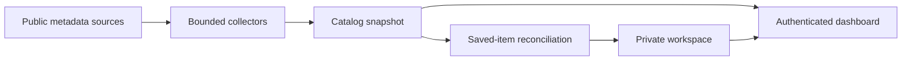

# Architecture

[← Back to Siggo](../README.md)

Siggo has two kinds of state: **what the sources publish** and **what you choose to follow**. Keeping them separate makes source failures visible without turning a lost listing into lost personal work.

## The shape of the system

The diagram shows data dependencies, not a single database transaction. Saved tracking is reconciled before a refreshed catalog is published.

| State     | Contains                                                                                                            | Storage                                     |
| --------- | ------------------------------------------------------------------------------------------------------------------- | ------------------------------------------- |
| Catalog   | Source listings, provenance, freshness, and internal collector progress                                             | Atomic JSONB snapshot in `catalog_snapshot` |
| Workspace | Preferences, saved/dismissed IDs, notes, personal listings, discovery baseline, saved snapshots, and unread changes | Per-user JSONB in `workspace`               |
| Identity  | Users, accounts, sessions, and verification records                                                                 | Better Auth's four authentication tables    |

“Public catalog” refers to the origin of the metadata, not anonymous access. Production still requires authentication. Personal listings never enter that catalog, and internal Codabench check history is excluded from dashboard props.

## Collection and publication

1. Load the previous public snapshot for source progress and failure recovery.
2. Read enabled sources within their budgets, pagination bounds, and access constraints.
3. Validate and deduplicate records, preserving compatible identity and discovery dates.
4. Reconcile saved snapshots and date changes for private workspaces.
5. Publish the refreshed durable catalog and invalidate its cached view.

A tracking persistence failure leaves the previous public snapshot available. Failed sources can retain previous records with explicit unavailable/stale metadata; memory recovery alone is not durable storage.

Source collection does not use a user's profile to decide catalog membership. Personalization ranks the available discovery set in the client. Its reasons and cautions are visible, while eligibility remains a sourced fact or an explicit unknown.

## Workspace ownership and concurrency

The browser serializes its writes. The server distinguishes user-edited content from managed tracking:

| User-edited                                                                      | Server-managed in cloud mode                                              |
| -------------------------------------------------------------------------------- | ------------------------------------------------------------------------- |
| Profile, bookmarks, dismissed IDs, notes, personal listings, participation plans | Visit baseline, saved snapshots, deadline changes, tracking-limit warning |

Content fields supplied by competing devices are last-write-wins; Siggo is not a real-time collaborative editor. Managed tracking uses compare-and-swap retries so refreshes and read acknowledgements cannot overwrite a concurrent note, bookmark, or visit marker. Unknown top-level workspace fields survive older-client/server writes during rolling updates.

Deadline acknowledgements refer to exact change versions. A delayed response cannot clear a newer change or restore an acknowledged one. Missing dates are not confirmed removals, and owner edits to personal listings do not generate source-change alerts.

Saved snapshots are private recovery data, not a second public feed:

- A missing record does not mean ended.
- A missing saved item can retain last-known details and editable notes without reappearing in discovery.
- Known ended items belong in Archive; a passed unverified provider cutoff is not an end date.
- Legacy bookmarks without retained metadata still expose their notes and private participation plans.
- Unsaving removes tracking state, not the associated note or plan.

The workspace limit is **1,000,000 serialized characters**. If automatic tracking reaches it, existing content is preserved and the UI asks the owner to free space. Dates or changes a source never exposed cannot be reconstructed retroactively.

## Comparison and participation

[Comparison](shortlist.md) is an ephemeral two-to-four-ID selection over available catalog/private-library facts. It does not mutate the workspace or consume model quota. Date semantics, indirect provenance, and saved-snapshot notices remain explicit.

Private `participationPlans` contain a personal stage and bounded task list. Starting a plan saves a known listing; unsaving retains the plan, and explicit personal-listing deletion removes it. Stage changes never alter source activity, deadlines, or registration facts. Plans use existing validated workspace JSONB with a legacy empty default and no new migration.

## Optional catalog assistant

[Ask Siggo](assistant.md) calls Groq once per authenticated question with a bounded projection of the durable catalog and recent chat text. General chat uses keyword selection; **Ask about this** uses exactly one validated current public record. Invalid, ended, or personal focus IDs fail before reserving quota. It does not read private workspace content, collect sources, browse links, or mutate user-edited fields. Structured answers use server-owned catalog links; unsupported citations and invalid output are rejected. This constrains links and structure, not factual accuracy.

Per-user request reservations use a conditional Postgres upsert and server-owned `assistantUsage` JSONB, without schema changes or another service. This operational field never reaches workspace responses and survives content writes through the existing unknown-field preservation. Chat text is not persisted. Provider credentials and error payloads stay server-side; replies are private and uncached.

## Privacy boundaries

- Production and Vercel deployments never enable credential-free local preview.
- GitHub OAuth identifies the permitted account; workspace access is checked server-side.
- Workspace mutations require authentication and the canonical origin.
- Scheduled sync requires a timing-safe Bearer-secret comparison.
- Database, OAuth, Kaggle, Groq, and cron secrets remain server-side and out of cache keys and client bundles.
- Zindi's browser receives a small environment allowlist, not application secrets, and has a restricted read-only network surface.
- Manual listing URLs are stored as destinations, never automatically scraped.

Implementation and integration tests are the authority for these boundaries. [Deployment](deployment.md) includes live verification checks; [Sources and data](sources.md) records access assumptions rather than treating technical reachability as permission.

## Module map

| Responsibility                                          | Entry point                                                                                                                |
| ------------------------------------------------------- | -------------------------------------------------------------------------------------------------------------------------- |
| Routes, authenticated page boundary, and API handlers   | [`src/app/`](../src/app/)                                                                                                  |
| Catalog, profile, date, and workspace schemas           | [`src/lib/model.ts`](../src/lib/model.ts)                                                                                  |
| Comparison and private preparation plans                | [`comparison.tsx`](../src/components/comparison.tsx), [`participation-plan.tsx`](../src/components/participation-plan.tsx) |
| Catalog-grounded chat and provider limits               | [`assistant-server.ts`](../src/lib/assistant-server.ts), [`assistant.ts`](../src/lib/assistant.ts)                         |
| Explainable relevance ranking                           | [`src/lib/ranking.ts`](../src/lib/ranking.ts)                                                                              |
| Discovery, reminders, and personal-listing behavior     | [`src/lib/workspace.ts`](../src/lib/workspace.ts)                                                                          |
| Browser persistence, write queue, and synchronization   | [`src/lib/workspace-store.ts`](../src/lib/workspace-store.ts)                                                              |
| Saved history and deadline-change reconciliation        | [`src/lib/saved-competitions.ts`](../src/lib/saved-competitions.ts)                                                        |
| Public collection, parsing, and failure recovery        | [`src/lib/sources/`](../src/lib/sources/)                                                                                  |
| Resumable Codabench phase checks                        | [`src/lib/sources/codabench.ts`](../src/lib/sources/codabench.ts)                                                          |
| Indirect TensorHack/calendar collection                 | [`src/lib/sources/devpost.ts`](../src/lib/sources/devpost.ts)                                                              |
| Zindi collection and isolated browser lifetime          | [`zindi.ts`](../src/lib/sources/zindi.ts), [`zindi-browser.ts`](../src/lib/sources/zindi-browser.ts)                       |
| Catalog caching, durable storage, and workspace updates | [`src/lib/server.ts`](../src/lib/server.ts)                                                                                |
| Authentication and request validation                   | [`auth.ts`](../src/lib/auth.ts), [`request-security.ts`](../src/lib/request-security.ts)                                   |
| Database connection and schema                          | [`src/db/`](../src/db/)                                                                                                    |
| Directory, dialogs, and UI primitives                   | [`src/components/`](../src/components/)                                                                                    |
| Unit, server, security, and browser coverage            | [`tests/`](../tests/)                                                                                                      |

## Compatibility

The brand is Siggo, while selected legacy identifiers remain deliberate compatibility contracts: older browser storage, the Better Auth cookie prefix, historical source identities, and the `SIGNAL_E2E` test switch. Renaming them for cosmetic consistency can discard a workspace or invalidate an existing session.

Keep database changes generated through Drizzle. Existing snapshot/history features fit the JSONB schema; do not add a service or migration merely to rearrange application state.
